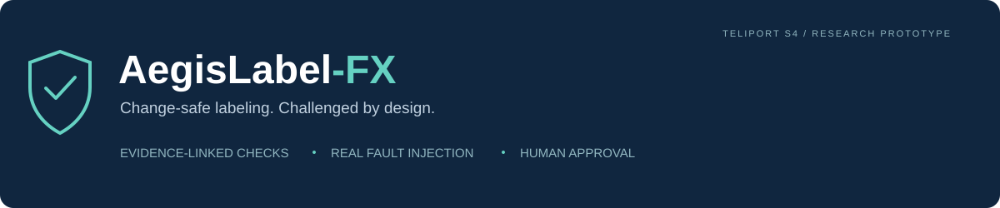
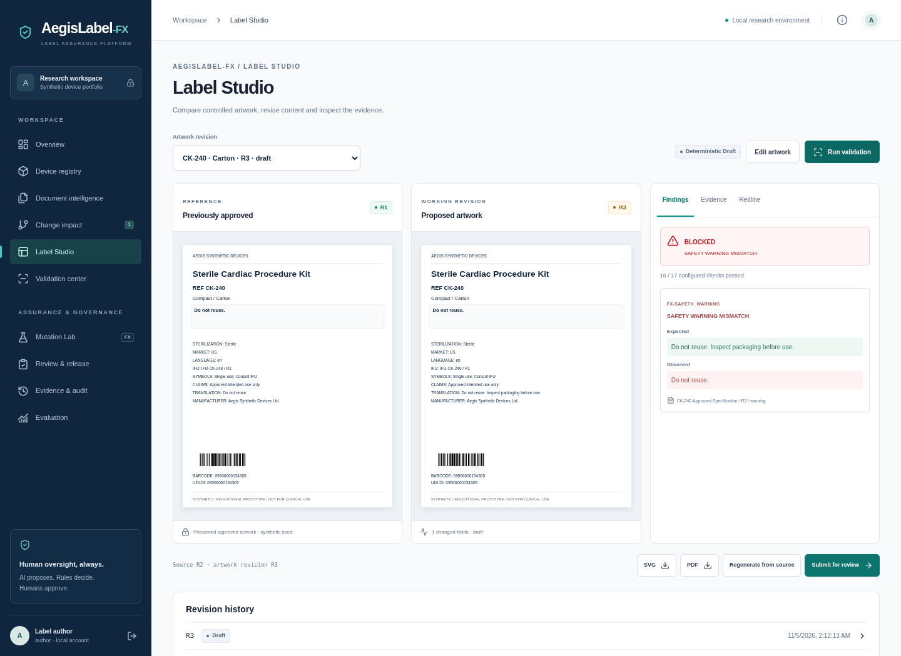
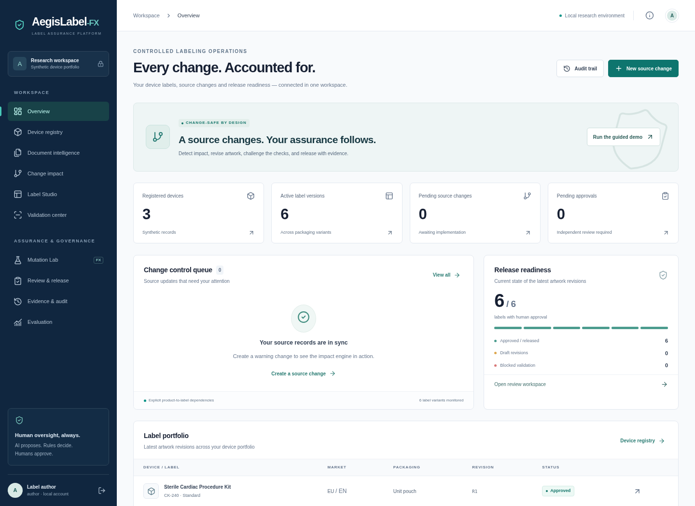
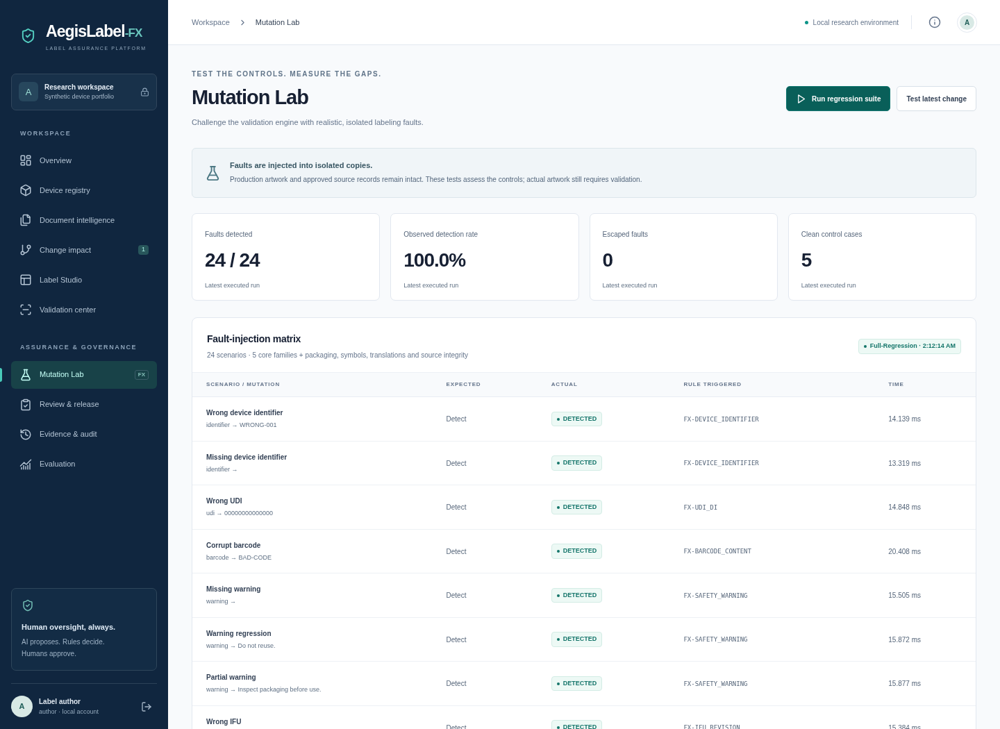
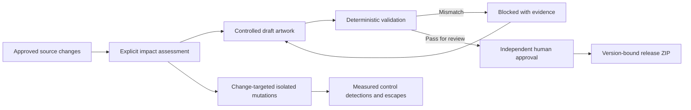

<p align="center"></p>

<p align="center">
  <a href="https://github.com/Pradhyut21/Aegislabel/actions/workflows/quality.yml"></a>
  <a href="https://github.com/Pradhyut21/Aegislabel/actions/workflows/codeql.yml"></a>
  
  
</p>

<p align="center"><strong>AI proposes. Rules decide. Humans approve.</strong></p>

AegisLabel-FX connects a specification change to affected medical-device labels, controlled artwork, deterministic findings, fault-injection tests and an exact-version human approval. Built for **Tata Elxsi TELIPORT Season 4 · Case Study 4**.

**Start here:** [Run locally](#quick-start--native-no-docker-required) · [Execute the demo](#reproduce-the-critical-demo) · [Architecture](docs/ARCHITECTURE.md) · [Evaluation](docs/EVALUATION.md) · [Verified results](docs/VERIFICATION.md) · [Security](SECURITY.md)

> **Educational research prototype.** Every application device and document is synthetic. A separate public FDA reference bundle is documented below. Checks cover a bounded configured ruleset, not complete regulatory requirements. This is not certified or validated for production. No public application deployment or paid AI access is required.

## The moment that matters

An approved warning changes from **“Do not reuse.”** to **“Do not reuse. Inspect packaging before use.”** A faulty draft retains the old warning. An unchanged warning in a visual comparison can still violate the newly approved specification. The validator blocks it, names the rule and shows the expected content and source evidence. A corrected revision can then be submitted to an independent human reviewer and released as actual SVG/PDF artwork with a traceable ZIP summary.



*Genuine application capture from an isolated synthetic workspace. The walkthrough and Playwright test execute this behavior against the API and database.*

## What makes this project different

Label creation, artwork comparison and approvals already exist in commercial products. The contribution here is their integration with **change-targeted fault injection and evidence-linked, version-bound release controls**.

| Capability | What actually executes |
| --- | --- |
| Change-aware revision | Approved source differences follow explicit field dependencies; unrelated labels retain their source snapshots. |
| Evidence-linked checks | Every controlled finding resolves to approved document evidence or a registered label configuration. |
| Mutation-guided regression | 24 synthetic faults run on isolated copies through the real validation engine. Change-targeted runs select relevant faults plus workflow controls. |
| Approval that cannot drift | Approval binds the exact SVG hash, source version and ruleset. A source change or newer artwork revision prevents stale release. |
| Honest comparison | Artwork-only, content-rules and full-workflow baselines execute on the same labeled cases; limitations and denominators are visible. |
| Reproducible handoff | A ZIP contains frozen SVG/PDF artwork, source evidence, findings, reviewer approval and a release timestamp. |

<details>
<summary><strong>See the operational workspace and Mutation Lab</strong></summary>





</details>

## Workflow at a glance



## Engineering and verification

React + TypeScript + Vite · FastAPI + Pydantic + SQLAlchemy · PostgreSQL or local SQLite · PyMuPDF · deterministic SVG and PDF generation · Pytest · Vitest · Playwright + axe.

The [verification report](docs/VERIFICATION.md) records executed commands and environment limits. GitHub Actions repeats backend checks on both databases, frontend checks, the complete browser journey, accessibility checks and a container smoke test. CodeQL and dependency updates complement the application tests. Workflow badges show actual GitHub status; they are not static success claims.

## Quick start — native, no Docker required

Python 3.12 and Node 22+ are recommended. Run from the project root:

```bash
git clone https://github.com/Pradhyut21/Aegislabel.git AegisLabel-FX
cd AegisLabel-FX
python -m venv .venv
source .venv/bin/activate
python -m pip install -r requirements.txt
mkdir -p artifacts
alembic upgrade head
cd frontend
npm ci
npm run build
cd ..
uvicorn backend.main:app --host 127.0.0.1 --port 8000 --workers 1
```

Open **http://localhost:8000**. The native fallback persists to `artifacts/aegis.db` using SQLite. Docker uses PostgreSQL. Changing DB engines does not migrate existing user data automatically.

| Local role | Username | Default password |
| --- | --- | --- |
| Label author | `author` | `Aegis-author-2026!` |
| Independent quality reviewer | `reviewer` | `Aegis-reviewer-2026!` |

These are clearly identified local demonstration accounts. Set `DEMO_AUTHOR_PASSWORD` and `DEMO_REVIEWER_PASSWORD` **before first seeding** to change initial credentials. Seed password settings do not change existing accounts. Do not expose this service publicly.

## Windows and limited C: storage

Place the source at `D:\AegisLabel-FX`. Before installing, inspect free disk space with `Get-PSDrive -PSProvider FileSystem` and tool versions with `node --version`, `python --version` and `docker info`. Keep the project, virtual environment, npm cache and browser binaries on D:.

```powershell
Set-Location D:\AegisLabel-FX
$env:PIP_CACHE_DIR = 'D:\AegisLabel-FX\.cache\pip'
$env:npm_config_cache = 'D:\AegisLabel-FX\.cache\npm'
$env:PLAYWRIGHT_BROWSERS_PATH = 'D:\AegisLabel-FX\.cache\browsers'
python -m venv .venv
.\.venv\Scripts\Activate.ps1
python -m pip install -r requirements.txt
New-Item -ItemType Directory -Force artifacts
alembic upgrade head
Set-Location frontend
npm ci
npm run build
Set-Location ..
python -m uvicorn backend.main:app --host 127.0.0.1 --port 8000 --workers 1
```

Docker Desktop commonly stores Linux images/volumes on C:. **Before building**, inspect Docker Desktop → Settings → Resources → Advanced → Disk image location (the precise control varies by backend/version). Move the disk image to D: through Docker Desktop and verify `docker info`/Desktop settings. For WSL-backed installations use Docker's documented supported storage-move process; do not manually delete or move a live VHDX. Native SQLite mode avoids Docker storage entirely.

## Docker Compose — PostgreSQL

```bash
docker compose up --build -d
```

The app binds only to `127.0.0.1:8000`; the database has no published host port. PostgreSQL data persists in its named volume. Stop using `docker compose down`; do not use `-v` unless intentionally discarding the local database. Only one app worker is supported.

In managed environments with a TLS proxy, pass the public CA as BuildKit secret `proxy_ca`; see `docs/ARCHITECTURE.md`. Do not disable TLS verification. A conventional local Docker build needs no secret.

## Reproduce the critical demo

1. Sign in as author. Click **Run the guided demo**, then **Start with a source change**.
2. Choose the cardiac kit and set warning to `Do not reuse. Inspect packaging before use.` Click **Detect & assess impact**.
3. Inspect two affected labels and four unrelated labels. Click **Generate draft** for the unit pouch.
4. In Label Studio, click **Edit artwork**, change warning to `Do not reuse.`, and save a new revision.
5. Click **Run validation**. Inspect **BLOCKED — SAFETY WARNING MISMATCH**, expected/observed warning, rule ID and source version. The evidence tab shows source quotes.
6. Click **Regenerate from source**, run validation and **Submit for review**. Passing does not approve the artwork.
7. Sign out. Sign in as reviewer. Open **Review & release**, inspect the artwork, click **Approve exact version**, then confirm.
8. Click **Generate release package** and download the ZIP: real PDF/SVG, frozen summary and source evidence.
9. In **Mutation Lab**, run the suite. Inspect the separately injected missing-warning test and actual triggered rules.
10. Open **Evidence & audit** and verify the hash chain. Change an approved artwork/source to demonstrate fresh approval is required.

Repeated source changes create new revisions. To replay the old→new warning transition exactly, first change back to `Do not reuse.` through the same controlled flow, then create the updated warning. Historical records are retained.

## Verification

```bash
python -m pip install -r requirements-dev.txt
python -m pytest -q
python -m scripts.benchmark
cd frontend
npm run typecheck
npm run lint
npm run format:check
npm test
npm run build
npx playwright install chromium
# Start the backend on localhost:8000 before the browser suite.
npm run test:e2e
```

Browser tests deliberately change the synthetic workspace. Use a separate `DATABASE_URL` when preserving demonstration records matters. Backend tests create their own temporary database. See [verified commands and limits](docs/VERIFICATION.md), [evaluation methodology](docs/EVALUATION.md), [architecture](docs/ARCHITECTURE.md) and [regulatory limits](docs/REGULATORY.md).

## Document intelligence and optional AI

Upload text-based PDFs using `field: value` lines (`name`, `identifier`, `variant`, `udi`, `barcode`, `warning`, `ifu`, `packaging`, `symbols`, `claims`, `language`, `translation`, `manufacturer`, `sterilization`, `market`). A reviewer must inspect extracted evidence and confirm complete source fields. Scanned files require external OCR; no text is invented.

Default outputs are explicitly marked **deterministic**. Optional drafting uses a server-only OpenAI-compatible Meta model endpoint: configure `AI_BASE_URL`, `AI_MODEL`, `AI_API_KEY`, and explicitly set `AI_ENABLED=true` only after authorizing potential charges. Environment variables must be exported; `.env.example` is documentation and is not automatically loaded. No local model download is needed. AI proposals still pass the same deterministic validation and human approval process.

Development UI: run `npm run dev` in `frontend` with the backend on port 8000. Public API documentation is available locally at `/docs`. Never place secrets in frontend environment variables.


## Additional reproducibility tools

- `python -m scripts.fixtures` regenerates the two actual sample specifications under `sample-data/`. Upload `cardiac-spec-r2.pdf` and inspect evidence as reviewer.
- `python -m scripts.export_openapi` exports the FastAPI contract; `npm run api:types` in `frontend/` regenerates TypeScript request schema definitions from it.
- PostgreSQL tests: start `docker compose -f compose.yaml -f compose.test.yaml up -d db`, create a dedicated database ending in `_test`, and set `TEST_DATABASE_URL` before running pytest. API tests clear/reseed only that explicitly selected test database for isolation. Never point tests at a workspace you want to preserve.
- Use `docker compose down` after container testing to stop local services while retaining their data.

For the exact verified Python dependency set, install `requirements.lock.txt` instead of the shorter direct-dependency list. The lock includes test/audit tools; Docker uses this exact lock.

## Repository policies

See [contribution guidance](CONTRIBUTING.md) and [security reporting](SECURITY.md). The code and synthetic fixtures are published for technical review; regulatory conformance and production suitability are not implied.

## Recorded demo, Meta integration and public reference data

- [Narrated real-app demo and reproducible capture/render commands](demo/README.md): BRAG-guided, locally synthesized voice, actual validation and approval screens.
- [Meta technology provenance](docs/META_PROVENANCE.md): actual React usage, optional native Llama SDK and current Meta Model API modes; **no live inference claimed**. Meta did not author or endorse this project.
- [Hackathon assessment](docs/HACKATHON_ASSESSMENT.md): the published November 4 deadline has passed; detailed eligibility, video duration and dataset policy remain unverified.
- [Combined public FDA reference data](data/reference/README.md): six UDI records joined to classification categories, eight explicit product-code matches with provenance. Separate from synthetic approvals and evaluation; not clinical ground truth or training data.
- [Third-party notices](THIRD_PARTY_NOTICES.md).
